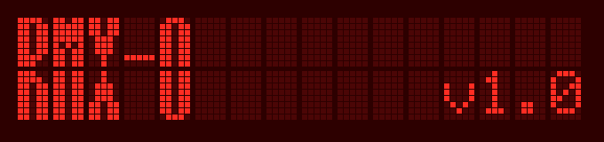

# RMX-0

Custom firmware for the Erica Synths LXR Eurorack drum module. It is built on Erica Synths' open-source module firmware (v1.51) and keeps everything the stock firmware does.

RMX-0 is unofficial. It is not made, approved or supported by Erica Synths.

*PRS are welcome!* Feel free to fork this and do whatever you want, if it works and is well tested i have no issues merging it back if that's what you'd like.

#### *things i didn't get around to*
- Multiple projects: The desktop LXR-02 allows you to group kits into projects. Because kits are stored on the SD card, there's really no reason to not have this feature on the module. Super easy fix, just not priority to me
- Sample Streaming: Samples could potentially stream from the SD card, bringing full-res sample time way past the ~17 seconds available in flash memory. The samples would need a few cycles preloaded, so that playback could start from flash while the stream starts from the card. This is a more involved implementation, but there's plenty of headroom

## Features

- **MIDI input** on the OP HH jack, with a channel and note per voice
- **Voice links:** drums 1–3 play as one instrument in unison, chord or poly mode
- **Glide and legato** per drum, with three glide curves
- **Global reverb** with per-voice sends, alongside the FX bus
- **Samples:** your own WAV files as oscillator waveforms, with start and end trims
- **Eleven new LFO shapes**, including smooth random and one-shot envelopes
- Pan that moves sounding notes, click-free retriggers and a restart menu

Kits from the stock firmware load unchanged, and RMX-0 kits still load on the stock firmware.

## Documentation

The user guide is in [`docs/`](docs/) and is published as the project's GitHub Pages site: installing, each feature, building from source and the [release notes](docs/release-notes.md).

## Installing

Download the latest `LXRE_RMX0_V<version>.img` from [Releases](https://github.com/mechanical-dance/RMX-0/releases/) and install it with the module's updater: copy it to the SD card, then hold the encoder while powering on. Full steps are in [docs/install.md](docs/install.md). Updating erases installed samples; reinstall them afterwards.

## Repository

| Folder | Contents |
|---|---|
| `firmware/` | Erica Synths' LXR Eurorack firmware with the RMX-0 additions. Build instructions: [docs/building.md](docs/building.md) |
| `docs/` | User guide (GitHub Pages) |
| `plans/` | Design notes for each feature |
| `tools/` | Tests that run the firmware on a computer, and kit tools |

## Credits

- **Erica Synths** for the LXR Eurorack module firmware, published under the GPL-3.0 ([lxr-eurorack-app](https://github.com/erica-synths/lxr-eurorack-app)).
- **Julian Schmidt (Sonic Potions)** for the original LXR drum machine and firmware.
- **Brendan Clarke** for [LXR02Open](https://github.com/brendanclarke/LXR02Open), which showed samples running from the module's flash and inspired several of the new LFO shapes.

More in [docs/credits.md](docs/credits.md).

## License

GPL-3.0-only, with Erica Synths' additional terms in [`firmware/NOTICE.md`](firmware/NOTICE.md). Full text: [`LICENSE`](LICENSE).

"Erica Synths", "LXR" and "LXR-02" are trademarks of Erica Synths, used here only to say which hardware RMX-0 runs on.
